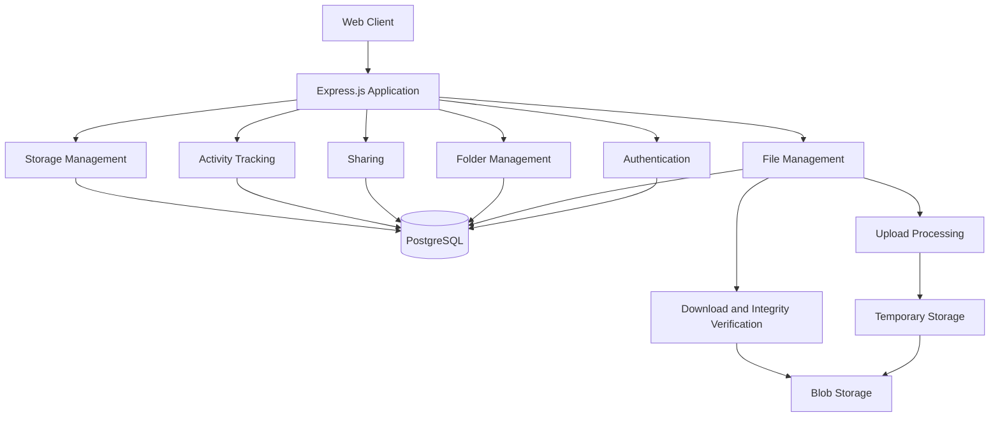

# CloudVault 
### Full-Stack Cloud Storage & File Management Platform

CloudVault is a full-stack cloud storage and file management platform built to provide users with a secure way to upload, organize, download, share, and manage their files.

The platform goes beyond basic file storage by implementing immutable file versioning, upload reliability mechanisms, file-integrity verification, session-based authentication, storage management, and concurrency-aware backend operations.

Built with **Node.js, Express.js, PostgreSQL, HTML, CSS, and JavaScript**, CloudVault focuses on practical backend engineering concepts and reliable file-storage workflows.

---

##  Features

### Authentication & Security
- User registration and login.
- Secure password hashing using bcrypt.
- Session-based authentication.
- PostgreSQL-backed session storage.
- HTTP-only session cookies.
- Protected file-management operations.
- Security headers using Helmet.
- Sensitive information redaction in HTTP logs.

### File Management
- Upload and download files.
- View and manage uploaded files.
- Organize files into folders.
- Update file metadata.
- Track file storage usage.
- Manage deleted files through a trash system.
- Restore deleted files.
- Permanently purge files.

### Immutable File Versioning
- Every new upload creates a separate file version.
- Previously uploaded versions are preserved.
- Sequential version numbering.
- Retrieve complete version history.
- Download specific historical versions.
- Prevent overwriting existing file-version contents.

### Reliable Upload Processing
- Idempotency-key-based upload handling.
- Duplicate request protection.
- Upload request tracking and leases.
- Concurrency-aware version allocation.
- Retry handling for conflicting operations.
- Temporary upload processing.
- Failure cleanup and storage consistency mechanisms.

### File Integrity
- SHA-256 checksums for file verification.
- Integrity verification during downloads.
- Separate storage for file contents and metadata.
- Individual stored content associated with file versions.

### File Sharing
- Share files with other users through supported sharing functionality.
- Create and manage public share links.
- Access shared files through public tokens.
- Download files through public sharing links.
- Manage and revoke sharing access.

### Activity & Storage Management
- Activity logging for supported file operations.
- Storage usage information.
- User storage quota management.
- Database-backed activity records.

---

## Technology Stack

| Category | Technologies |
|---|---|
| Frontend | HTML, CSS, JavaScript |
| Backend | Node.js, Express.js 5 |
| Database | PostgreSQL |
| Database Driver | node-postgres (`pg`) |
| Authentication | express-session, bcryptjs |
| Session Storage | connect-pg-simple |
| File Uploads | Multer |
| Security | Helmet |
| Logging | Pino HTTP |
| File Integrity | SHA-256 |
| File Storage | Local filesystem |
| Development | npm, Git |

---

## System Architecture

CloudVault uses a client-server architecture. Express serves the frontend and handles API requests, while PostgreSQL stores application metadata and the local filesystem stores file contents.



### Storage Architecture

CloudVault separates file metadata from actual file contents.

- **PostgreSQL:** Stores user information, file metadata, version records, folders, sharing information, activity records, and sessions.
- **Temporary storage:** Handles files during upload processing.
- **Blob storage:** Stores the actual uploaded file contents.

This separation helps maintain organized metadata and supports independent file-version management.

---

## Immutable File Versioning

A core design principle of CloudVault is its append-only file versioning approach.

When a user uploads a file again, the platform creates a new version instead of replacing the contents of an existing version.

For example:

| Upload | Version | Behaviour |
|---|---|---|
| First upload | v1 | Original content stored |
| Second upload | v2 | New version created |
| Third upload | v3 | Previous versions preserved |
| Fourth upload | v4 | Complete history maintained |

Users can view the version history and download a particular version when needed.

This approach helps prevent accidental loss of historical file contents.

---

## Reliability & Concurrency

CloudVault includes backend mechanisms designed to make file operations more reliable.

**Idempotent uploads**
- Upload requests use idempotency keys.
- Duplicate requests can be identified.
- Retries are handled without unnecessarily creating duplicate uploads.

**Concurrency handling**
- Version allocation accounts for overlapping upload operations.
- Database constraints and retry mechanisms help protect version consistency.
- Upload request leases support reliable operation tracking.

**Storage consistency**
- Temporary upload processing.
- Storage quota checks.
- Blob creation and metadata recording.
- Upload-operation state management.
- Failure handling and cleanup.
- Durable purge-job support.

---

## Database & Migrations

PostgreSQL is the primary relational database.

The database supports:
- User accounts and authentication.
- File metadata and version history.
- Folder organization.
- Sharing and public share links.
- Activity records.
- User sessions.
- Upload request tracking.
- Storage management and quota information.

Database migrations are maintained in `server/src/db/migrations/`:

| Migration | Purpose |
|---|---|
| `001_initial_schema.sql` | Initial database schema |
| `002_upload_request_leases.sql` | Upload request lease support |
| `003_durable_purge_jobs.sql` | Durable purge-job support |
| `004_unique_active_file_names.sql` | Uniqueness for active file names |
| `005_add_purged_at.sql` | Purge timestamp tracking |

Apply the migrations in numerical order when setting up a new database.

---

## API Overview

The backend exposes REST API modules for the platform's main operations.

| API Base Path | Functionality |
|---|---|
| `/api/health` | Application and database health |
| `/api/auth` | Registration, login, logout and user sessions |
| `/api/files` | Uploads, downloads, file listing and version history |
| `/api/files` | Sharing, public links, trash, restore and deletion |
| `/api/folders` | Folder creation, listing, updating and deletion |
| `/api/activity` | Activity records |
| `/api/storage` | Storage usage information |

Authentication is required for protected file and folder operations. Public share-link access is supported separately.

Local development API address:

```text
http://localhost:3000
```

---

## Project Structure

```text
cloud-storage-platform-starter/
│
├── client/
│   ├── index.html
│   ├── share.html
│   ├── css/
│   │   ├── styles.css
│   │   └── share.css
│   └── js/
│       ├── app.js
│       └── share.js
│
├── server/
│   ├── src/
│   │   ├── config/
│   │   ├── db/
│   │   │   └── migrations/
│   │   ├── middleware/
│   │   ├── routes/
│   │   │   ├── health.routes.js
│   │   │   ├── auth.routes.js
│   │   │   ├── files.routes.js
│   │   │   ├── folders.routes.js
│   │   │   ├── activity.routes.js
│   │   │   └── storage.routes.js
│   │   ├── app.js
│   │   └── server.js
│   │
│   ├── scripts/
│   ├── storage/
│   │   ├── tmp/
│   │   └── blobs/
│   │
│   └── package.json
│
├── .gitignore
└── README.md
```

---

##  Getting Started

### Prerequisites

- Node.js
- npm
- PostgreSQL
- Git

### 1. Clone the repository

```bash
git clone https://github.com/Siddhant608/cloud-storage-platform.git
cd cloud-storage-platform
```

### 2. Install backend dependencies

```bash
cd server
npm install
```

### 3. Create the PostgreSQL database

```sql
CREATE DATABASE cloud_storage_db;
```

### 4. Configure environment variables

Create a `.env` file inside the `server` directory.

Use the project's `.env.example` as a reference and configure the required database connection, session secret, and application settings.

Do not commit credentials or secrets to GitHub.

### 5. Apply database migrations

Apply the SQL migration files inside:

```text
server/src/db/migrations/
```

Run them in numerical order, from `001_initial_schema.sql` through `005_add_purged_at.sql`.

### 6. Start the development server

```bash
npm run dev
```

The backend runs using Node.js watch mode.

The application serves the frontend through the Express server.

### 7. Run tests

```bash
npm test
```

---

## Testing

The application has undergone functional and concurrent API testing. The local backend successfully completed a mixed API test involving 500 requests with zero reported HTTP failures.

---

## Future Improvements

- Integration with cloud object storage.
- More advanced sharing permissions.
- Improved search and filtering.
- File preview and thumbnail generation.
- Expanded automated testing.
- Production deployment and scalability improvements.
- Enhanced monitoring and observability.

---

## Key Engineering Concepts

CloudVault brings together several practical software engineering concepts:

- Full-stack application development.
- REST API design.
- Relational database management.
- Secure authentication and session management.
- File storage architecture.
- Immutable data versioning.
- Idempotent request processing.
- Concurrency control.
- File-integrity verification.
- Database migrations and constraints.
- Error handling and storage consistency.

---

## Project Status

CloudVault is an actively developed cloud-storage and file-management platform. Its implemented functionality covers authentication, file operations, immutable versioning, sharing, folder management, trash and recovery, storage tracking, and upload reliability.

Further development is focused on scalability, security, and production readiness.
